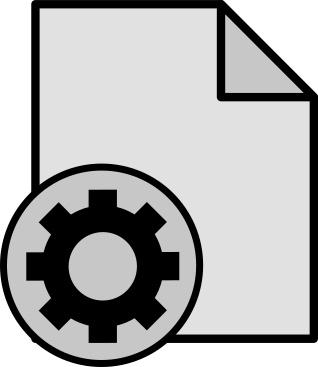

## Welcome to my profile 👋
###### Digital Graphics | Scripting Developer | Portable Software Packaging

## 👨‍💻 About Me

I'm a **Computer Graphics Technician (EQF Level 5)** with a background in digital graphics, web technologies and software development.

My interests include scripting, software development, **portable software packaging and distribution**, and workflow automation. I also have experience in digital content creation, desktop publishing and software troubleshooting.

I enjoy exploring technologies and developing practical solutions through experimentation and independent projects.

<!--
<table style="width:100%">
  <tr>
    <th>🚀 Projects</th>
  </tr>
  <tr>
    <td>👉 <a href="pages/projects.md">View my projects</a></td>
  </tr>
</table>
-->

<!-- https://simpleicons.org/ -->

<!--

<td align="center"></td>
<td align="center">Ini File Configuration</td>
<td align="center">Paint.NET Graphics</td>
-->

## 🖥️ Languages
 &nbsp;  &nbsp;  &nbsp;  &nbsp;  &nbsp; 

## 🧩 Occasional Use
 &nbsp;  &nbsp; 

## 🛠️ Tools
 &nbsp;  &nbsp;  &nbsp;  &nbsp;  &nbsp;  &nbsp;  &nbsp;  &nbsp;  &nbsp;  &nbsp;  &nbsp;  &nbsp;  &nbsp;  &nbsp; 

# My playlist
<!-- BEGIN YOUTUBE-CARDS -->

[")](https://www.youtube.com/watch?v=EFt9m5YAkpw)
[")](https://www.youtube.com/watch?v=2Ete5axG66M)
[")](https://www.youtube.com/watch?v=CQTBKRWhoRQ)

[")](https://www.youtube.com/watch?v=FWJmww5nmeY)

<!-- END YOUTUBE-CARDS -->

<!-- --- -->

<!--

-->

<!--
**SimoLRepo/SimoLRepo** is a ✨ _special_ ✨ repository because its `README.md` (this file) appears on your GitHub profile.

Here are some ideas to get you started:

- 🔭 I’m currently working on ...
- 🌱 I’m currently learning ...
- 👯 I’m looking to collaborate on ...
- 🤔 I’m looking for help with ...
- 💬 Ask me about ...
- 📫 How to reach me: ...
- 😄 Pronouns: ...
- ⚡ Fun fact: ...
-->
